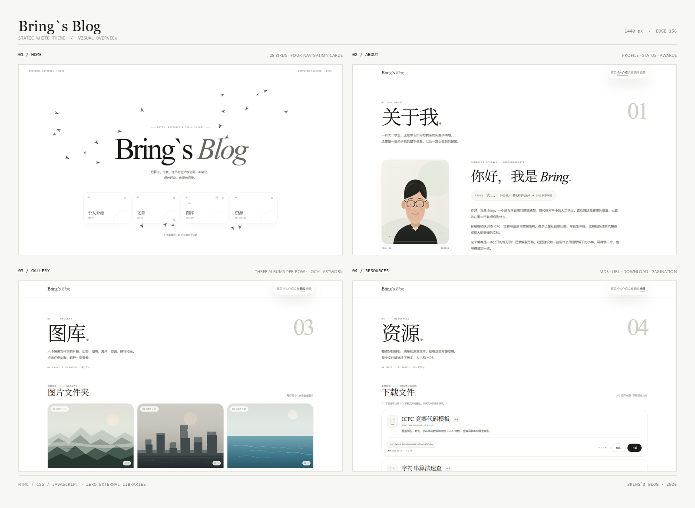

# Bring`s Blog

一个白色、简介风格的静态博客效果示例：纯 HTML / CSS / JavaScript，**零前端框架、零外部字体、零图标库、无后端**。



## 快速开始

直接双击 `index.html` 即可浏览；也可以启动一个静态服务器：

```bash
cd D:\codex\blog
python -m http.server 4173 --bind 127.0.0.1
```

打开 <http://127.0.0.1:4173/>。

## 页面

| 页面 | 路径 | 内容 |
| --- | --- | --- |
| 首页 | `index.html` | 上方中部品牌、四个一行导航、25 只鸟的 Canvas Boids 动画 |
| 个人介绍 | `about.html` | 头像、大二状态、个人简介、圆角奖项卡片 |
| 文章 | `articles.html` → `notes.html?folder=...&page=...` → `note.html?id=...` | 四个文件夹、分页笔记列表、正文 |
| 图库 | `gallery.html` | 每行 3 个圆角图集文件夹，键盘可操作的图片灯箱 |
| 资源 | `resources.html?page=...` | 9 个真实示例文件、MD5、版本、`URL` 按钮、`下载` 按钮、分页 |

## 效果要点

- **25 只鸟**：Canvas 2D、分离 / 对齐 / 聚合、上下左右环面连通、鼠标避让；鸟身为凹四边形 + 加粗中线，Canvas 固定在内容最底层。
- **白色简介风**：暖灰辅助色、衬线大标题、细描边圆角卡片、克制动效。
- **响应式**：桌面 1440px 与移动端 390px 均验证；图库在移动端仍保持每行 3 个。
- **无外部库**：图标为内联 SVG，图片为本地 SVG，字体使用系统字体。
- **可访问性**：skip link、焦点样式、灯箱焦点回收与 `Esc` 关闭、`prefers-reduced-motion` 支持。

## 后端接口

当前数据全部由 `js/data.js` 与 `js/notes-data.js` 提供 Mock，页面统一通过
`window.BlogAPI` 获取。接口层在 `js/api.js`，切换方式：

```js
window.BLOG_API_CONFIG = {
  useMock: true,   // 改为 false，请求 /api/...
  baseUrl: "/api",
  mockDelay: 90,
};
```

已预留的接口包括个人资料、奖项、文章文件夹、分页笔记、笔记详情、图集、
资源分页、签名下载与下载统计。完整契约、字段说明与后端待办见
[continue/08-backend-api.md](continue/08-backend-api.md)。

## 目录

```text
.
├─ *.html                 # 7 个页面
├─ css/style.css          # 全部样式
├─ js/
│  ├─ data.js             # Mock：资料 / 奖项 / 文件夹 / 图库 / 资源
│  ├─ notes-data.js       # Mock：24 篇笔记正文
│  ├─ api.js              # API 边界 + [后端预留] 端点
│  ├─ common.js           # 导航、菜单、分页、工具函数
│  ├─ home.js             # 25 只鸟群集动画
│  └─ ...                 # 各页面渲染
├─ assets/
│  ├─ AR.png
│  ├─ favicon.svg
│  ├─ gallery/            # 18 张本地图库 SVG
│  └─ files/              # 9 个可下载示例文件
├─ continue/              # 每步变更、验证和后端契约
└─ README.md
```

## 验证

- 真实浏览器（Edge headless + CDP）自动化检查 **62 / 62 通过**；
- 控制台错误、未捕获异常、HTTP ≥400 均为 0；
- 9 个下载文件 MD5 与页面数据、服务器返回内容完全一致；
- 18 张图库图片、96 个本地链接全部存在；
- 直接通过 `file://` 打开首页与个人介绍页也能正常工作。

详细记录见 [continue/README.md](continue/README.md) 与
[continue/07-quality.md](continue/07-quality.md)。

> 所有博客内容、奖项与图集均为演示数据。
